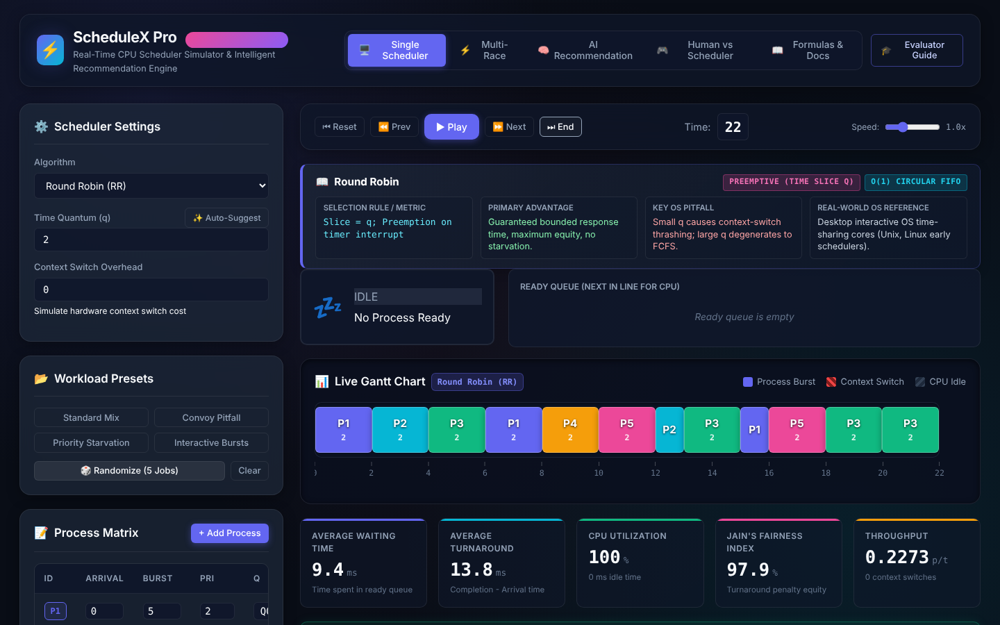
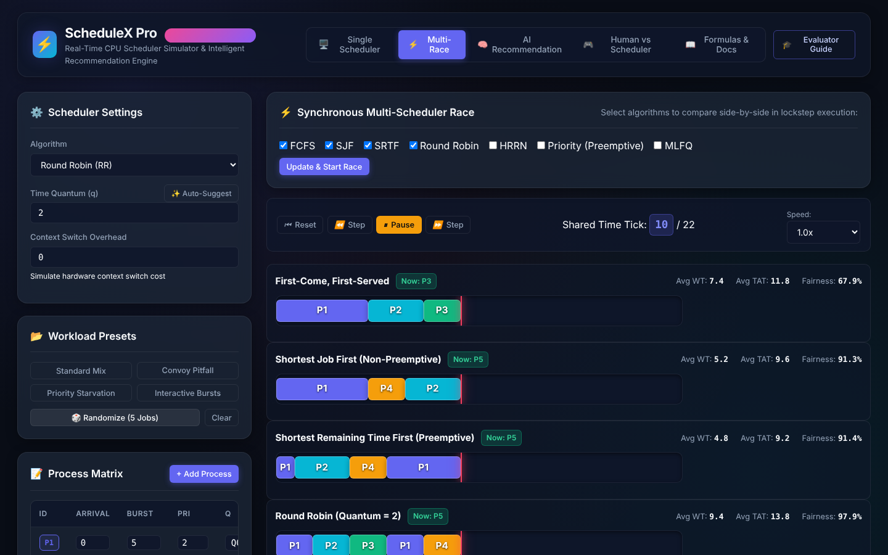

# ScheduleX Pro

**A CPU scheduling simulator with live Gantt charts, multi-scheduler racing, and a multi-criteria recommendation engine.**

ScheduleX Pro runs 9 classic CPU scheduling algorithms in the browser, animates every tick, and then tells you *which* algorithm suits your workload best and *why*. It is plain HTML, CSS and JavaScript with no build step and no dependencies.



---

## Contents

- [Features](#features)
- [What makes it different](#what-makes-it-different)
- [Getting started](#getting-started)
- [Running the tests](#running-the-tests)
- [Project structure](#project-structure)
- [Mathematical formulations](#mathematical-formulations)
- [Tech stack](#tech-stack)

---

## Features

### Algorithm suite

| Algorithm | Type | Notes |
|---|---|---|
| FCFS (First-Come, First-Served) | Non-preemptive | Baseline; convoy-effect detection |
| SJF (Shortest Job First) | Non-preemptive | |
| SRTF (Shortest Remaining Time First) | Preemptive | |
| Round Robin | Preemptive | Configurable time quantum *q* and context-switch overhead |
| Priority | Non-preemptive | Configurable low/high priority order |
| Priority | Preemptive | |
| HRRN (Highest Response Ratio Next) | Non-preemptive | Starvation-free |
| MLQ (Multilevel Queue) | Preemptive | Foreground RR, background FCFS |
| MLFQ (Multilevel Feedback Queue) | Preemptive | 3 queues, demotion and aging |

### Live visualisation
- **Animated Gantt chart** that grows tick by tick, with a playhead, context-switch dividers and CPU-idle gaps.
- **CPU core visualiser** showing the running process and its remaining burst.
- **Ready-queue pipeline** showing who is next in line.
- **Playback controls**: play, pause, step forward/back, jump to end, reset, and speed from 0.25× to 3×.

### Human vs Scheduler game
You act as the kernel dispatcher and pick which ready process gets the CPU at each tick. At the end, your schedule is compared with the optimal SRTF schedule, and you get a rank, an efficiency rating and achievements.

### Linux-style kernel syslog (`/dev/kmsg`)
A live trace of scheduler events (`TASK_RUNNING`, `sched_switch`, `sched_preempt`, `cpu_idle`, `TASK_DEAD`) with colour-coded tags, copy and clear.

### Algorithm spec card
For the selected algorithm: selection rule, dispatch complexity, preemption type, main advantage, key pitfall, and where it is used in real operating systems (Linux CFS, XNU, FreeBSD, VxWorks).

### Workload presets, import and export
Standard Mix, Convoy Pitfall, Priority Starvation, Interactive Bursts and a random generator, plus JSON import/export of processes and CSV export of metrics.

### Evaluator guide
A built-in walkthrough modal that presents the project's features step by step for demos and viva.

---

## What makes it different

Most simulators show a static Gantt chart for one algorithm. ScheduleX Pro adds:

### 1. Multi-criteria recommendation engine
Runs all 9 algorithms on the same workload and scores each across 8 dimensions:

- Average waiting, turnaround and response time
- CPU utilisation and throughput
- Context-switch count
- **Jain's fairness index**
- **Starvation risk** and **convoy-effect detection**

The scores are combined with a weighted multi-attribute decision model (MADM) under a selectable goal: *Balanced Desktop OS*, *Low Latency / Interactive*, *Maximum Fairness* or *High Throughput Batch*. A verdict card explains why the winner was chosen and how much waiting time it saves compared with FCFS. One click deploys the winner into the simulator.


### 2. Multi-scheduler race mode
Runs 2–7 schedulers side by side in lockstep on the same arrival and burst sequence, with one shared timeline.



### 3. Adaptive time-quantum suggester
Suggests a Round Robin quantum *q\** from the workload's burst distribution, using the 80th-percentile rule: about 80% of CPU bursts should be shorter than the quantum.

---

## Getting started

No installation is needed.

**Option 1: open the file.** Double-click `index.html`, or open it in any modern browser.

**Option 2: run a local server** (needs [Node.js](https://nodejs.org)):

```bash
npm start
```

This serves the project at <http://localhost:8080> and opens it in your browser.

---

## Running the tests

The test suite checks every algorithm's output, convoy and starvation detection, the recommendation engine and the game engine.

```bash
npm test
# or
node tests/schedulers.test.js
```

---

## Project structure

```
.
├── index.html                      # App shell and all UI markup
├── package.json                    # npm start / npm test scripts (no dependencies)
├── src/
│   ├── css/
│   │   ├── style.css               # Design system: dark theme, layout grid, base styles
│   │   ├── components.css          # Spec card, syslog terminal, modals, KPI cards, toasts
│   │   ├── gantt.css               # Gantt chart and timeline tracks
│   │   └── game.css                # Human vs Scheduler game UI
│   └── js/
│       ├── models/
│       │   └── Process.js          # Process Control Block (PCB) model
│       ├── algorithms/
│       │   ├── fcfs.js             # First-Come, First-Served
│       │   ├── sjf.js              # Shortest Job First (non-preemptive)
│       │   ├── srtf.js             # Shortest Remaining Time First (preemptive)
│       │   ├── roundRobin.js       # Round Robin with quantum and switch overhead
│       │   ├── priority.js         # Priority (non-preemptive and preemptive)
│       │   ├── hrrn.js             # Highest Response Ratio Next
│       │   ├── mlq.js              # Multilevel Queue
│       │   └── mlfq.js             # Multilevel Feedback Queue with aging
│       ├── engine/
│       │   ├── simulator.js        # Step-by-step playback controller
│       │   ├── evaluator.js        # Metrics, fairness and risk diagnostics
│       │   ├── recommendationEngine.js  # MADM scoring and quantum tuner
│       │   └── gameEngine.js       # Human vs Scheduler state machine
│       ├── visualizers/
│       │   ├── ganttChart.js       # Gantt chart renderer
│       │   ├── stateVisualizer.js  # CPU core and ready-queue animation
│       │   └── multiRace.js        # Multi-scheduler race tracks
│       └── app.js                  # UI controller: events, presets, syslog, modals
├── tests/
│   └── schedulers.test.js          # Automated verification suite
└── docs/
    └── screenshots/                # Images used in this README
```

**How the scripts fit together:** `index.html` loads the files in dependency order with plain `<script>` tags: model, then algorithms, engine, visualizers, and finally `app.js`. Each module also exports itself through `module.exports` when it runs in Node, so the same files work in the browser and in the test suite.

---

## Mathematical formulations

| Metric | Formula |
|---|---|
| Turnaround time | $\text{TAT} = \text{Completion} - \text{Arrival}$ |
| Waiting time | $\text{WT} = \text{TAT} - \text{Burst}$ |
| Response time | $\text{RT} = \text{First CPU run} - \text{Arrival}$ |
| CPU utilisation | $\dfrac{\text{Total time} - \text{Idle time}}{\text{Total time}} \times 100\%$ |
| Throughput | $\dfrac{N}{\text{Total time}}$ |
| HRRN response ratio | $R = \dfrac{W + S}{S} = 1 + \dfrac{W}{S}$, where $W$ is waiting time and $S$ is burst time |

**Jain's fairness index**, computed on normalised turnaround penalties $x_i = \text{TAT}_i / \text{BT}_i$:

$$J(x) = \frac{\left(\sum_{i=1}^{n} x_i\right)^2}{n \sum_{i=1}^{n} x_i^2}, \quad J \in [0, 1]$$

---

## Tech stack

- **HTML5, CSS3, vanilla JavaScript (ES6+)**, with no frameworks and no build step
- **Node.js** only for the test suite and the optional local server
